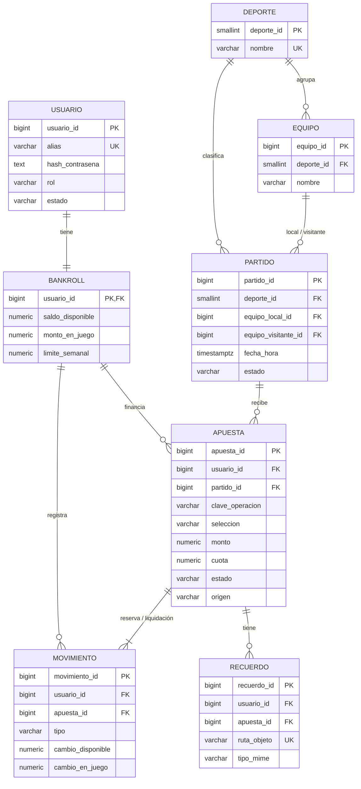

# Base de datos de BANKDOIT (PostgreSQL)

Issue #16. Responsable: Osvaldo Yair Serna Salazar.

Esquema relacional de BANKDOIT a partir del diseño de [docs/distribucion-datos.md](../docs/distribucion-datos.md) (#3), alineado con el contrato de la API en [docs/api-bankroll.md](../docs/api-bankroll.md). Por ahora es **una sola base local**; la separación en fragmentos impar/par y sus réplicas es el Issue #17.

## Archivos

| Archivo | Contenido |
| --- | --- |
| `sql/01_esquema.sql` | Tablas, llaves primarias y foráneas, restricciones `CHECK`/`UNIQUE` e índices |
| `sql/02_funciones_triggers.sql` | Triggers de integridad y funciones de negocio que usará la API |
| `sql/03_datos_prueba.sql` | Catálogo y los dos usuarios de ejemplo de #3 (3 y 4) |
| `pruebas/pruebas_integridad.sql` | Pruebas que demuestran cada regla (terminan en `ROLLBACK`) |
| `docker-compose.yml` | PostgreSQL 16 en contenedor; carga `sql/` al crear la base |
| `probar_desde_cero.ps1` | Borra la base, la crea vacía, carga los scripts y corre las pruebas |

## Cómo ejecutarlo

Requisitos: Docker Desktop abierto. Desde PowerShell, en la carpeta `database`:

```powershell
Copy-Item .env.example .env      # solo la primera vez; cambia la contraseña
.\probar_desde_cero.ps1
```

El script borra el volumen, levanta un PostgreSQL vacío, ejecuta `sql/01` a `sql/03` y corre las pruebas. Debe terminar con `>>> TODAS LAS PRUEBAS PASARON`. Si una regla falla, se detiene con `FALLO: ...`.

Para entrar a la base: `docker compose exec postgres psql -U bankdoit -d bankdoit` (o pgAdmin/DBeaver en `localhost:5432`).

## Modelo



### Decisiones de diseño

- **Un solo bankroll por usuario:** la llave primaria de `bankroll` es el propio `usuario_id`, así que no puede existir un segundo.
- **`usuario_id` en todas las tablas personales** (bankroll, apuesta, movimiento, recuerdo). Es la shard key de #3: en #17 cada fragmento tendrá completo lo de sus usuarios. Las llaves foráneas compuestas `(apuesta_id, usuario_id)` garantizan que un movimiento o recuerdo pertenezca al mismo dueño que su apuesta.
- **Dinero en `NUMERIC`**, nunca `FLOAT`: `monto NUMERIC(10,2)`, `cuota NUMERIC(6,2)`, saldos `NUMERIC(12,2)`; coinciden con las validaciones de la API.
- **Movimientos con signo** (`cambio_disponible`, `cambio_en_juego`), igual que el modelo de la API. El saldo guardado en `bankroll` siempre debe ser igual a la suma de los movimientos (`conciliar_bankroll()` lo comprueba).
- **Normalización (3FN):** los catálogos (deporte, equipo, partido) están separados; ningún atributo depende de algo que no sea la llave de su tabla. El único dato derivado es el saldo del bankroll, que se guarda para poder bloquear la fila y leerlo rápido, y se mantiene solo por trigger.
- **Los recuerdos no guardan la imagen**, solo su ruta privada, tipo y tamaño (máximo 10 MB).

## Reglas implementadas

| Regla | Dónde |
| --- | --- |
| Alias único y con formato válido | `UNIQUE` + `CHECK` en `usuario` |
| Un bankroll por usuario | PK de `bankroll` = `usuario_id` |
| Monto > 0 con centavos, cuota > 1 | `CHECK` en `apuesta` + validación en `registrar_apuesta` |
| Estados `pendiente`, `ganada`, `perdida`, `anulada` | `CHECK` en `apuesta` |
| Partido con dos equipos distintos del mismo deporte | `CHECK` + FK compuestas `(equipo_id, deporte_id)` |
| El saldo nunca es negativo | `CHECK` en `bankroll` |
| Solo se apuesta lo disponible | `registrar_apuesta` → `saldo_insuficiente` |
| Apuesta + reserva + movimiento en una sola transacción | `registrar_apuesta` |
| Reenviar el mismo borrador no cobra dos veces | `UNIQUE (usuario_id, clave_operacion)` + `registrar_apuesta` + `UNIQUE (apuesta_id, tipo)` |
| Misma clave con otros datos se rechaza | `registrar_apuesta` → `clave_reutilizada` |
| Liquidación correcta de ganada/perdida/anulada | `resolver_apuesta` |
| Una apuesta resuelta no cambia de resultado | `resolver_apuesta` + trigger `trg_apuesta_transicion` |
| Un usuario no resuelve apuestas de otro | `resolver_apuesta` → `apuesta_inexistente` |
| El saldo solo cambia mediante movimientos | triggers `trg_movimiento_aplicar` y `trg_bankroll_proteger` |
| El historial no se edita ni se borra | triggers `trg_movimiento_inmutable` y `trg_apuesta_no_borrar` |
| Ninguna apuesta existe sin su reserva | trigger diferido `trg_apuesta_con_movimiento` |
| Aportaciones/retiros no cuentan como ganancia | tipos de movimiento propios + `ganancia_neta` |
| Limpieza de sesiones y conciliación periódica | procedimiento `mantenimiento_diario()` (#56, en `distribuido/`) |
| Monto apostado en la semana (alerta de límite) | `apostado_semana` (no bloquea; la app pregunta) |

### Por qué función, trigger o restricción

- **Restricciones (`CHECK`, `UNIQUE`, FK):** reglas sobre una sola fila o una relación; las garantiza el motor sin código.
- **Triggers:** reglas que deben cumplirse aunque alguien escriba SQL directo (no pasar por la API): el saldo se actualiza solo con movimientos, el historial es inmutable y no hay apuestas sin reserva.
- **Funciones:** operaciones de negocio de varios pasos que deben ser una transacción atómica y devolver errores claros: registrar y resolver apuestas, aportaciones, retiros y consultas de resumen.
- **Procedimiento:** tareas de administración que confirman su trabajo por partes (`COMMIT` dentro del procedimiento) y se ejecutan con `CALL`: `mantenimiento_diario()` (#56).

## Funciones para la API

| Función | Devuelve | Errores (`SQLSTATE P0001`, mensaje) |
| --- | --- | --- |
| `crear_usuario(alias, hash, saldo_inicial, limite_semanal, rol, usuario_id)` | `usuario_id` | `saldo_inicial_invalido` |
| `registrar_apuesta(usuario_id, clave, partido_id, seleccion, monto, cuota, origen)` | `apuesta_id, estado, saldo_disponible, monto_en_juego, es_reenvio` | `usuario_inexistente`, `usuario_suspendido`, `clave_reutilizada`, `partido_inexistente`, `partido_no_disponible`, `monto_invalido`, `cuota_invalida`, `saldo_insuficiente` |
| `resolver_apuesta(usuario_id, apuesta_id, resultado)` | igual que arriba | `resultado_invalido`, `apuesta_inexistente`, `resultado_en_conflicto` |
| `registrar_aportacion(usuario_id, importe)` | `saldo_disponible, monto_en_juego` | `importe_invalido` |
| `registrar_retiro(usuario_id, importe)` | `saldo_disponible, monto_en_juego` | `importe_invalido`, `saldo_insuficiente` |
| `apostado_semana(usuario_id)` | monto de la semana | — |
| `ganancia_neta(usuario_id)` | ganancia o pérdida deportiva | — |
| `conciliar_bankroll()` | una fila por usuario con `cuadra` | — |

Sugerencia de mapeo para la API: `es_reenvio = true` → 200, `false` → 201; `saldo_insuficiente`, `clave_reutilizada` y `resultado_en_conflicto` → 409; `*_inexistente` → 404; `*_invalido` / `*_invalida` → 422.

Ejemplo:

```sql
SELECT * FROM registrar_apuesta(3, 'b7c1e9d2-uuid-del-borrador', 101, 'América', 100.00, 2.00);
SELECT * FROM resolver_apuesta(3, 1, 'ganada');
SELECT * FROM v_bankroll_resumen WHERE usuario_id = 3;
```

## Base distribuida (#17)

La separación en fragmentos impar/par con réplicas síncronas, las secuencias por paridad y la copia del catálogo están en [distribuido/](distribuido/README.md). Esta carpeta (`sql/`) sigue siendo la base de una sola instancia que usan ambos fragmentos.

Pendiente: rol de la API con permiso solo para ejecutar las funciones (sin `INSERT`/`UPDATE` directos).
