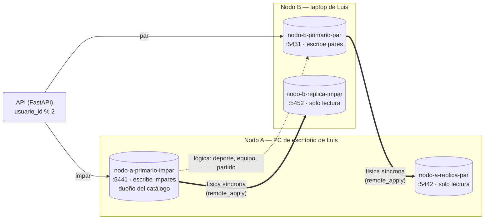

# Fragmentos de PostgreSQL y sus réplicas

Issues #17 (fragmentos y réplicas), #18 (pruebas de falla), #32 (acceso de la API), #56 (mantenimiento), #57 (respaldos de PostgreSQL), #58 (respaldos de MongoDB) y #59 (monitoreo). Responsable: Osvaldo Yair Serna Salazar.

Aplica la distribución de [docs/distribucion-datos.md](../../docs/distribucion-datos.md) (#3) sobre el esquema de [database/sql](../sql) (#16): usuarios impares en el primario del Nodo A (PC de escritorio de Luis), pares en el primario del Nodo B (laptop de Luis), y cada fragmento con una réplica síncrona en el otro equipo.

## Arquitectura



| Instancia | Nodo | Rol | Contiene |
| --- | --- | --- | --- |
| `nodo-a-primario-impar` | A | Primario F-impar | Usuarios impares + catálogo (dueño) |
| `nodo-b-replica-impar` | B | Réplica de F-impar | Copia exacta del primario impar |
| `nodo-b-primario-par` | B | Primario F-par | Usuarios pares + copia del catálogo |
| `nodo-a-replica-par` | A | Réplica de F-par | Copia exacta del primario par |

## Cómo se implementa

| Requisito | Mecanismo | Archivo |
| --- | --- | --- |
| Impares en el Nodo A, pares en el Nodo B | `CHECK (usuario_id % 2 = resto)` en cada primario: un fragmento rechaza usuarios de la otra paridad | `init/10_fragmento.sh` |
| Bankroll, apuestas y movimientos juntos | Todas esas tablas tienen FK a `usuario`/`bankroll` del mismo fragmento, así que no pueden quedar separadas de su usuario | `../sql/01_esquema.sql` |
| Id sin choques entre fragmentos | Identidades con paso 2: impar 1, 3, 5…; par 2, 4, 6… (usuario, apuesta, movimiento, recuerdo) | `init/10_fragmento.sh` |
| Réplica en el otro equipo | Replicación física por streaming: `pg_basebackup` + `standby.signal` + ranura de replicación | `init/replica.sh` |
| Consistencia del saldo (postura CP) | `synchronous_standby_names` + `synchronous_commit = remote_apply`: el COMMIT espera a que la réplica lo aplique | `init/10_fragmento.sh` |
| Catálogo igual en ambos fragmentos | Replicación lógica: `PUBLICATION catalogo` en el primario impar y `SUBSCRIPTION` en el par; en el par el catálogo es de solo lectura | `init/10_fragmento.sh`, `init/suscribir_catalogo.sh` |
| Réplicas no aceptan escrituras | Modo `hot_standby`: solo lectura | `init/replica.sh` |

## Simulación en una sola computadora

Requisitos: Docker Desktop abierto. En PowerShell, desde `database\distribuido`:

```powershell
Copy-Item .env.example .env      # solo la primera vez; cambia las dos contraseñas
.\levantar_y_probar.ps1
```

El script borra la simulación anterior, levanta los dos primarios y luego las réplicas, carga el catálogo en el primario impar, lo suscribe en el par, registra a los usuarios 3 y 4 en su fragmento y ejecuta las comprobaciones. Debe terminar con `>>> TODAS LAS COMPROBACIONES PASARON`.

### Resultado: dónde se escribe cada registro y dónde aparece su réplica

Conteo `usuario / bankroll / apuestas / movimientos` en cada instancia:

| Instancia | Usuario 3 (`ana_gol`) | Saldo 3 | Usuario 4 (`beto_td`) | Saldo 4 |
| --- | --- | --- | --- | --- |
| Nodo A · primario impar | **1/1/2/4** | 940.00 / 100.00 | 0/0/0/0 | — |
| Nodo B · réplica impar | **1/1/2/4** | 940.00 / 100.00 | 0/0/0/0 | — |
| Nodo B · primario par | 0/0/0/0 | — | **1/1/1/2** | 600.00 / 200.00 |
| Nodo A · réplica par | 0/0/0/0 | — | **1/1/1/2** | 600.00 / 200.00 |

- El usuario 3 se escribe en el **Nodo A** y su réplica está en el **Nodo B**; el usuario 4 al revés.
- Sus 2 y 1 apuestas viajan con su bankroll y sus 4 y 2 movimientos (saldo inicial, reservas y liquidación).
- Los saldos coinciden con la sección 4.4 de `docs/distribucion-datos.md`.

El script también comprueba:

- Una apuesta nueva del usuario 3 ya está en la réplica del Nodo B al terminar el `COMMIT`.
- Un usuario creado en el primario par recibe un id par (6) y aparece en la réplica del Nodo A.
- Un partido nuevo creado en el primario impar llega al primario par y a las dos réplicas.
- El fragmento impar rechaza un usuario par y viceversa (`ck_usuario_fragmento`).
- Las réplicas rechazan escrituras (`read-only transaction`).
- El catálogo no se puede editar en el fragmento par (`catalogo_solo_lectura`).
- En las cuatro instancias el bankroll cuadra con sus movimientos y apuestas pendientes.

Los contenedores quedan arriba para revisarlos con pgAdmin/DBeaver en `localhost` puertos 5441, 5442, 5451 y 5452. Para apagarlos:

```powershell
docker compose --profile nodo-a --profile nodo-b down        # conserva los datos
docker compose --profile nodo-a --profile nodo-b down -v     # los borra
```

## Despliegue real en dos equipos

El mismo `docker-compose.yml` sirve para los dos equipos con perfiles; solo cambia `.env`.

1. **VPN entre los dos equipos** (por ejemplo Tailscale o ZeroTier, gratis). Cada equipo obtiene una IP privada de la VPN. No se abren puertos a internet.
2. **PC de escritorio de Luis (Nodo A).** En `.env`:
   ```
   BIND_IP=<IP de la PC de escritorio de Luis>
   PAR_PRIMARIO_HOST=<IP de la laptop de Luis>
   PAR_PRIMARIO_PUERTO=5451
   ```
   y `docker compose --profile nodo-a up -d nodo-a-primario-impar`.
3. **Laptop de Luis (Nodo B).** En `.env`:
   ```
   BIND_IP=<IP de la laptop de Luis>
   IMPAR_PRIMARIO_HOST=<IP de la PC de escritorio de Luis>
   IMPAR_PRIMARIO_PUERTO=5441
   ```
   y `docker compose --profile nodo-b up -d nodo-b-primario-par`.
4. Con los dos primarios arriba, levantar las réplicas: `docker compose --profile nodo-a up -d` en A y `docker compose --profile nodo-b up -d` en B.
5. En el Nodo B: `docker exec nodo-b-primario-par bash /scripts/suscribir_catalogo.sh`.

Las dos computadoras deben usar las **mismas contraseñas** en `.env` (`POSTGRES_PASSWORD` y `REPLICADOR_PASSWORD`); se comparten por un medio privado, nunca en el repositorio.

## Pruebas de falla y recuperación (#18)

```powershell
.\probar_fallas.ps1
```

Levanta la simulación desde cero, ejecuta los dos escenarios por separado y guarda la evidencia de saldos, movimientos y operaciones en [evidencia/evidencia_fallas.md](evidencia/evidencia_fallas.md). Debe terminar con `>>> TODAS LAS COMPROBACIONES PASARON`.

### Escenario 1 · Partición de red

Se desconectan de la red los dos contenedores del Nodo B; los cuatro siguen encendidos.

| Operación | Resultado |
| --- | --- |
| Consultar saldos (primarios y réplicas) | Confirmada: devuelve el último dato confirmado |
| Registrar una apuesta (usuario 3 o 4) | **En espera:** el `COMMIT` espera a la réplica del otro nodo y nadie más ve la apuesta |
| Dar de alta un partido | **En espera**, igual que las apuestas |
| Escribir en una réplica | Rechazada (solo lectura) |
| Al reconectar | Las escrituras en espera se confirman solas, las réplicas se ponen al día y los saldos coinciden |
| Reenviar el mismo borrador | Confirmada sin doble cargo (`es_reenvio = true`, una sola reserva) |

Ningún saldo cambia durante la partición. Esto confirma la postura **CP**: se sacrifica la disponibilidad de escritura para no confirmar nada que no tenga copia.

### Escenario 2 · Caída del primario par y recuperación controlada

Se apaga de golpe `nodo-b-primario-par` (`docker kill`).

| Operación | Resultado |
| --- | --- |
| Consultar el saldo del usuario 4 en su réplica | Confirmada |
| Registrar una apuesta del usuario 4 | Rechazada: no hay primario; la app guarda el borrador |
| Registrar una apuesta del usuario 3 (fragmento impar) | **Confirmada:** el otro fragmento no se ve afectado |

Procedimiento de recuperación:

1. **Aislar** el primario anterior: queda apagado, sin reinicio automático y desconectado de la red, para que no vuelva como segundo primario (*split-brain*). Su disco ya no se usa.
2. **Promover** la réplica par del Nodo A: `SELECT pg_promote();`. El directorio de la API debe enviar a los usuarios pares a esa instancia. Hasta tener réplica, el nuevo primario **deja en espera** las escrituras, porque conserva `synchronous_standby_names = 'replica_par'`.
3. **Resincronizar** el equipo del Nodo B: se reconstruye como `nodo-b-replica-par` con `pg_basebackup` desde el nuevo primario (`SELECT pg_create_physical_replication_slot('replica_par');` antes). Con la copia síncrona al día, la escritura en espera se confirma.
4. **Avanzar la visibilidad:** `SELECT txid_current();` en el nuevo primario. Sin este paso, la réplica recién copiada trataba como "futura" la transacción que estaba en espera durante la copia y no la mostraba hasta la siguiente escritura. `pg_log_standby_snapshot()` y `CHECKPOINT` no lo resolvieron.

Al final, el fragmento par tiene su primario en el Nodo A y su réplica en el Nodo B, sin datos perdidos ni duplicados, y la suscripción del catálogo continúa en el primario promovido. Regresar el primario al Nodo B (*failback*) sería repetir el mismo procedimiento en sentido contrario.

### Advertencia para la API

Si la API cancela una consulta que espera a la réplica (por ejemplo, por un *timeout* que cancela la sentencia), PostgreSQL avisa que la transacción **ya se confirmó en el primario aunque no se haya replicado**. Por eso la API no debe cancelar esas escrituras: debe responder "pendiente" y dejar que la app reenvíe el borrador con la misma `Idempotency-Key`, que devuelve la apuesta original sin volver a cobrar.

## Acceso de la API (#32)

La API se conecta a cada primario con la cuenta `bankdoit_api` por TLS (`sslmode=verify-full`). El directorio único de cuentas y las sesiones viven en el primario impar. Pasos, variables, funciones disponibles y lo que implementa Luis en Python: [GUIA_CONEXION_API.md](GUIA_CONEXION_API.md).

```powershell
.\generar_certificados.ps1      # CA de pruebas y certificados en certs\ (fuera del repositorio)
.\levantar_y_probar.ps1
.\configurar_acceso_api.ps1     # rol, directorio, pg_hba con TLS y verificación (repetible)
```

| Archivo | Contenido |
| --- | --- |
| `init/20_acceso_api.sql` | Rol `bankdoit_api`, permisos mínimos, funciones `consultar_bankroll` y `consultar_historial`, funciones de negocio como `SECURITY DEFINER` |
| `init/21_directorio_cuentas.sql` | Tablas `cuenta` y `sesion` y sus funciones (solo primario impar) |
| `init/20_acceso_api.sh` | Aplica lo anterior y reescribe `pg_hba.conf` (API solo con TLS y desde orígenes permitidos) |
| `init/tls.sh` | Deja el certificado del nodo con los permisos que exige PostgreSQL |
| `cliente/verificar_conexion_api.py` | Cliente psycopg configurado como la API; verifica TLS, permisos y el flujo con dos cuentas |
| `evidencia/evidencia_conexion_api.md` | Resultado de la última verificación |

Para ensayar sin tocar otra instalación se puede usar otro proyecto y prefijo de contenedores: `$env:BANKDOIT_PROYECTO='bankdoit-ensayo'; $env:BANKDOIT_PREFIJO='ensayo-'` y otros puertos (`PUERTO_A_PRIMARIO`, etc.) y subred (`RED_DOCKER_SUBNET`).

**Instalación anterior a #32:** los contenedores necesitan recrearse para activar TLS (`docker compose ... up -d`, los volúmenes se conservan). Si la red `bankdoit-distribuido_default` ya existe con otra subred, Docker pedirá quitarla (`docker network rm bankdoit-distribuido_default`) antes de recrear.

## Procedimiento de mantenimiento (#56)

`init/22_mantenimiento.sql` crea en cada primario el procedimiento `mantenimiento_diario(p_lote)` y la tabla `bitacora_mantenimiento`. Se instala con `configurar_acceso_api.ps1` (o `20_acceso_api.sh`) y se puede reinstalar sin perder la bitácora.

```sql
CALL mantenimiento_diario();        -- lotes de 1000
```

| Paso | Qué hace |
| --- | --- |
| 1 | Borra las sesiones vencidas (solo en el primario impar, donde vive el directorio) **por lotes, con `COMMIT` entre lotes**, para no bloquear el inicio de sesión |
| 2 | Ejecuta `conciliar_bankroll()` y cuenta los bankrolls que no cuadran con sus movimientos y apuestas pendientes |
| 3 | Registra sesiones eliminadas, lotes, bankrolls revisados y descuadrados (con detalle) y duración en `bitacora_mantenimiento`; avisa con `WARNING` si hay descuadres |

**Por qué procedimiento y no función:** una función corre dentro de una sola transacción y no puede hacer `COMMIT`. El procedimiento sí, así que puede confirmar cada lote por separado, y se invoca con `CALL` como tarea de administración. Un procedimiento con control de transacciones no puede ser `SECURITY DEFINER` ni llevar `SET search_path`, por eso usa nombres calificados con `public.` y solo lo ejecuta el administrador: `bankdoit_api` no tiene permiso, y en una réplica responde `solo_en_primario`.

Prueba y evidencia:

```powershell
.\probar_mantenimiento.ps1      # después de levantar_y_probar.ps1 y configurar_acceso_api.ps1
```

Crea 2,500 sesiones vencidas y 3 vigentes, simula un saldo alterado por fuera de las funciones y comprueba que el `CALL` borra las vencidas en 3 lotes, conserva las vigentes, detecta el descuadre, se replica y respeta los permisos. Resultado en [evidencia/evidencia_mantenimiento.md](evidencia/evidencia_mantenimiento.md).

Para ejecutarlo a diario (por ejemplo con el Programador de tareas de Windows en cada equipo):

```powershell
docker exec nodo-a-primario-impar psql -U bankdoit -d bankdoit -c "CALL mantenimiento_diario()"
docker exec nodo-b-primario-par   psql -U bankdoit -d bankdoit -c "CALL mantenimiento_diario()"
```

## Respaldo y restauración (#57)

Cada primario archiva su WAL de forma continua (`archive_mode = on`, `archive_command` hacia `respaldos/wal/<fragmento>`, como mínimo cada 60 s). Las réplicas tienen la misma configuración para seguir archivando si se promueven (#18).

```powershell
.\respaldar.ps1            # respaldo lógico + físico de ambos fragmentos y retención
.\probar_respaldos.ps1     # restauración, recuperación a un punto en el tiempo y retención
```

| Respaldo | Herramienta | Dónde (`respaldos\`, fuera del repositorio) | Para qué |
| --- | --- | --- | --- |
| Lógico | `pg_dump -Fc` | `logico/<frag>/bankdoit_<frag>_<fecha>.dump` | Restaurar en otra versión o servidor, revisar datos |
| Roles | `pg_dumpall --roles-only --no-role-passwords` | `logico/<frag>/roles_<frag>_<fecha>.sql` | Recrear roles; **sin contraseñas** |
| Físico | `pg_basebackup -Ft -z -X stream` | `base/<frag>/<fecha>/` | Base para la recuperación a un punto en el tiempo |
| WAL | `archive_command` | `wal/<frag>/` | Reproducir los cambios posteriores al respaldo físico |
| Manifiesto | `respaldar.ps1` | `manifiestos/<frag>_<fecha>.json` | Tamaños, sha256 y conteos para validar la restauración |

`respaldar.ps1` detecta qué instancia es primaria en cada fragmento (también después de una promoción) y ejecuta `init/respaldar.sh` dentro del contenedor como el usuario `postgres`.

**Retención:** el más reciente de cada uno de los últimos 7 días con respaldo, más el más reciente de cada una de las últimas 4 semanas (lógicos); los 2 respaldos físicos más recientes, y se borra con `pg_archivecleanup` el WAL anterior al físico más viejo que se conserva. Se ajusta con `RESPALDO_DIARIOS`, `RESPALDO_SEMANALES` y `RESPALDO_FISICOS`.

**Prueba (`probar_respaldos.ps1`):**

1. Restaura cada respaldo lógico en un PostgreSQL limpio y **sin red**, verifica el sha256 y compara conteos, saldos, restricciones, triggers y la conciliación con el manifiesto.
2. **Recuperación a un punto en el tiempo:** registra una apuesta válida, marca `pg_create_restore_point(...)`, comete un error (suspender todas las cuentas), y recupera el respaldo físico + WAL con `recovery_target_name`. La base recuperada tiene la apuesta y las cuentas activas, sin el error.
3. Retención con 40 días de respaldos simulados.

Resultado en [evidencia/evidencia_respaldos.md](evidencia/evidencia_respaldos.md).

**Restaurar en producción:** detener la API, restaurar el respaldo físico en el primario afectado siguiendo el mismo procedimiento de la prueba (`restore_command` y `recovery_target_name` o `recovery_target_time`), reconstruir su réplica con `pg_basebackup` y conciliar. **Copiar `respaldos\` fuera del equipo** (otro disco, otra casa o almacenamiento en la nube, cifrado): un respaldo en el mismo disco no protege si se pierde el equipo. Para programarlo a diario se puede usar el Programador de tareas de Windows con `powershell -File <ruta>\respaldar.ps1`.

## Respaldo de MongoDB de análisis (#58)

La base `bankdoit_analytics` (colección `resumenes`, un documento por archivo procesado con su `corte_utc`) se respalda con `mongodump` desde `analytics\`:

```powershell
cd analytics
.\respaldar_mongo.ps1           # respaldos\mongo_<fecha>.archive.gz + manifiesto .json
.\probar_respaldo_mongo.ps1     # ensayo aislado: respaldo, restauración y retención
```

- **Manifiesto:** sha256 del archivo, documentos por colección y la hora de corte de cada resumen.
- **Retención:** la misma que PostgreSQL (7 diarios y 4 semanales).
- **Puerto configurable:** `analytics/compose.yaml` usa `MONGO_PUERTO` (27017 por omisión) para convivir con otro MongoDB local; si cambias el puerto, ajusta `MONGODB_URI` de `procesar.py` y de la API.
- **Prueba** (MongoDB de ensayo en el puerto 27018, no toca otro MongoDB): publica dos cortes con `procesar.py`, respalda, restaura en un MongoDB limpio y sin red con el mismo contenido y las mismas horas de corte, borra la colección del original y la recupera con `mongorestore --drop`, y comprueba que reprocesar el CSV conserva la hora de corte original.

Resultado en [evidencia/evidencia_respaldo_mongo.md](evidencia/evidencia_respaldo_mongo.md). Los resúmenes se pueden regenerar desde sus datos de origen, así que este respaldo protege sobre todo las **horas de corte** que muestra la app.

## Monitoreo (#59)

`init/23_monitoreo.sql` (lo instala `20_acceso_api.sh`) agrega dos funciones a cada instancia:

| Función | Qué devuelve |
| --- | --- |
| `estado_replicacion()` | En un primario: cada réplica con su estado, sincronía, bytes de WAL pendientes, retrasos y la ranura que la retiene |
| `estado_nodo()` | En cualquier instancia: fragmento, rol, réplicas síncronas, escrituras esperando a la réplica (`SyncRep`), bloqueos, transacciones largas, conexiones, retraso de réplica, archivado de WAL, último mantenimiento (#56) y tamaño |

**`monitorear.ps1`** revisa las cuatro instancias y alerta si una no responde, si un primario no tiene su réplica síncrona, si hay escrituras esperando a la réplica, si una réplica va atrasada, si el archivado de WAL falla, si el último mantenimiento encontró descuadres o si las conexiones pasan del 80 %.

```powershell
.\monitorear.ps1              # una revisión (sale con código 1 si hay alertas)
.\monitorear.ps1 -Continuo    # cada 5 s, hasta Ctrl+C
.\probar_monitoreo.ps1        # antes, durante y después de una partición de red
```

**Tablero opcional (Prometheus + Grafana):** un `postgres_exporter` por instancia se conecta por TLS (`verify-full`) con el rol de solo lectura `bankdoit_monitor` (miembro de `pg_monitor`, sin acceso a tablas) y publica también las métricas de `estado_nodo()` y `estado_replicacion()` (`monitoreo/queries.yaml`).

```powershell
docker compose --profile nodo-a --profile nodo-b --profile monitoreo up -d
```

Grafana queda en http://127.0.0.1:3000 (usuario `admin`, contraseña `GRAFANA_ADMIN_PASSWORD` de `.env`) con el tablero **BANKDOIT · PostgreSQL distribuido**: instancias arriba, réplica síncrona por primario, escrituras esperando a la réplica, WAL pendiente, conexiones, descuadres y archivado. Prometheus queda en http://127.0.0.1:9090.

En la prueba, durante la partición `monitorear.ps1` alertó que ambos primarios perdieron su réplica síncrona y que había una escritura esperando; Prometheus mostró esa escritura y marcó como inalcanzables las instancias del Nodo B; al reconectar, todo volvió a cero alertas. Resultado en [evidencia/evidencia_monitoreo.md](evidencia/evidencia_monitoreo.md).

## Consideraciones y pendientes

- **Escrituras en espera si cae la réplica.** Con replicación síncrona, si el otro equipo se desconecta, el primario deja los `COMMIT` en espera en lugar de confirmar sin copia. Es la postura CP acordada: la app guarda borradores (ver #18).
- **El catálogo depende del Nodo A.** Si el primario impar no está disponible, no se pueden dar de alta partidos nuevos; los existentes siguen disponibles en el fragmento par.
- **Alias único entre fragmentos.** Cada fragmento garantiza alias únicos solo entre sus usuarios. Falta acordar con Luis un directorio `alias → usuario_id` para el registro y el login.
- **Seguridad para el despliegue real.** Limitar `pg_hba.conf` a la subred de la VPN, activar TLS y crear el rol de la API con permiso solo para ejecutar las funciones.
