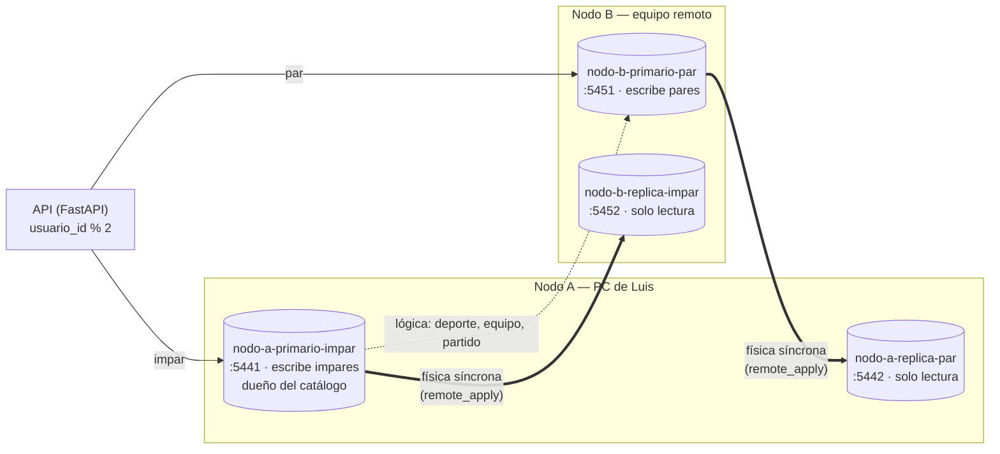

# Fragmentos de PostgreSQL y sus réplicas

Issue #17. Responsable: Osvaldo Yair Serna Salazar.

Aplica la distribución de [docs/distribucion-datos.md](../../docs/distribucion-datos.md) (#3) sobre el esquema de [database/sql](../sql) (#16): usuarios impares en el primario del Nodo A (PC de Luis), pares en el primario del Nodo B (remoto), y cada fragmento con una réplica síncrona en el otro equipo.

## Arquitectura



| Instancia | Nodo | Rol | Contiene |
| --- | --- | --- | --- |
| `nodo-a-primario-impar` | A | Primario F-impar | Usuarios impares + catálogo (dueño) |
| `nodo-b-replica-impar` | B | Réplica de F-impar | Copia exacta del primario impar |
| `nodo-b-primario-par` | B | Primario F-par | Usuarios pares + copia del catálogo |
| `nodo-a-replica-par` | A | Réplica de F-par | Copia exacta del primario par |

## Cómo se implementa

| Requisito | Mecanismo | Archivo |
| --- | --- | --- |
| Impares en el Nodo A, pares en el Nodo B | `CHECK (usuario_id % 2 = resto)` en cada primario: un fragmento rechaza usuarios de la otra paridad | `init/10_fragmento.sh` |
| Bankroll, apuestas y movimientos juntos | Todas esas tablas tienen FK a `usuario`/`bankroll` del mismo fragmento, así que no pueden quedar separadas de su usuario | `../sql/01_esquema.sql` |
| Id sin choques entre fragmentos | Identidades con paso 2: impar 1, 3, 5…; par 2, 4, 6… (usuario, apuesta, movimiento, recuerdo) | `init/10_fragmento.sh` |
| Réplica en el otro equipo | Replicación física por streaming: `pg_basebackup` + `standby.signal` + ranura de replicación | `init/replica.sh` |
| Consistencia del saldo (postura CP) | `synchronous_standby_names` + `synchronous_commit = remote_apply`: el COMMIT espera a que la réplica lo aplique | `init/10_fragmento.sh` |
| Catálogo igual en ambos fragmentos | Replicación lógica: `PUBLICATION catalogo` en el primario impar y `SUBSCRIPTION` en el par; en el par el catálogo es de solo lectura | `init/10_fragmento.sh`, `init/suscribir_catalogo.sh` |
| Réplicas no aceptan escrituras | Modo `hot_standby`: solo lectura | `init/replica.sh` |

## Simulación en una sola computadora

Requisitos: Docker Desktop abierto. En PowerShell, desde `database\distribuido`:

```powershell
Copy-Item .env.example .env      # solo la primera vez; cambia las dos contraseñas
.\levantar_y_probar.ps1
```

El script borra la simulación anterior, levanta los dos primarios y luego las réplicas, carga el catálogo en el primario impar, lo suscribe en el par, registra a los usuarios 3 y 4 en su fragmento y ejecuta las comprobaciones. Debe terminar con `>>> TODAS LAS COMPROBACIONES PASARON`.

### Resultado: dónde se escribe cada registro y dónde aparece su réplica

Conteo `usuario / bankroll / apuestas / movimientos` en cada instancia:

| Instancia | Usuario 3 (`ana_gol`) | Saldo 3 | Usuario 4 (`beto_td`) | Saldo 4 |
| --- | --- | --- | --- | --- |
| Nodo A · primario impar | **1/1/2/4** | 940.00 / 100.00 | 0/0/0/0 | — |
| Nodo B · réplica impar | **1/1/2/4** | 940.00 / 100.00 | 0/0/0/0 | — |
| Nodo B · primario par | 0/0/0/0 | — | **1/1/1/2** | 600.00 / 200.00 |
| Nodo A · réplica par | 0/0/0/0 | — | **1/1/1/2** | 600.00 / 200.00 |

- El usuario 3 se escribe en el **Nodo A** y su réplica está en el **Nodo B**; el usuario 4 al revés.
- Sus 2 y 1 apuestas viajan con su bankroll y sus 4 y 2 movimientos (saldo inicial, reservas y liquidación).
- Los saldos coinciden con la sección 4.4 de `docs/distribucion-datos.md`.

El script también comprueba:

- Una apuesta nueva del usuario 3 ya está en la réplica del Nodo B al terminar el `COMMIT`.
- Un usuario creado en el primario par recibe un id par (6) y aparece en la réplica del Nodo A.
- Un partido nuevo creado en el primario impar llega al primario par y a las dos réplicas.
- El fragmento impar rechaza un usuario par y viceversa (`ck_usuario_fragmento`).
- Las réplicas rechazan escrituras (`read-only transaction`).
- El catálogo no se puede editar en el fragmento par (`catalogo_solo_lectura`).
- En las cuatro instancias el bankroll cuadra con sus movimientos y apuestas pendientes.

Los contenedores quedan arriba para revisarlos con pgAdmin/DBeaver en `localhost` puertos 5441, 5442, 5451 y 5452. Para apagarlos:

```powershell
docker compose --profile nodo-a --profile nodo-b down        # conserva los datos
docker compose --profile nodo-a --profile nodo-b down -v     # los borra
```

## Despliegue real en dos equipos

El mismo `docker-compose.yml` sirve para los dos equipos con perfiles; solo cambia `.env`.

1. **VPN entre los dos equipos** (por ejemplo Tailscale o ZeroTier, gratis). Cada equipo obtiene una IP privada de la VPN. No se abren puertos a internet.
2. **PC de Luis (Nodo A).** En `.env`:
   ```
   BIND_IP=<IP VPN de la PC de Luis>
   PAR_PRIMARIO_HOST=<IP VPN del nodo remoto>
   PAR_PRIMARIO_PUERTO=5451
   ```
   y `docker compose --profile nodo-a up -d nodo-a-primario-impar`.
3. **Nodo remoto (Nodo B).** En `.env`:
   ```
   BIND_IP=<IP VPN del nodo remoto>
   IMPAR_PRIMARIO_HOST=<IP VPN de la PC de Luis>
   IMPAR_PRIMARIO_PUERTO=5441
   ```
   y `docker compose --profile nodo-b up -d nodo-b-primario-par`.
4. Con los dos primarios arriba, levantar las réplicas: `docker compose --profile nodo-a up -d` en A y `docker compose --profile nodo-b up -d` en B.
5. En el Nodo B: `docker exec nodo-b-primario-par bash /scripts/suscribir_catalogo.sh`.

Las dos computadoras deben usar las **mismas contraseñas** en `.env` (`POSTGRES_PASSWORD` y `REPLICADOR_PASSWORD`); se comparten por un medio privado, nunca en el repositorio.

## Consideraciones y pendientes

- **Escrituras en espera si cae la réplica.** Con replicación síncrona, si el otro equipo se desconecta, el primario deja los `COMMIT` en espera en lugar de confirmar sin copia. Es la postura CP acordada: la app guarda borradores. La promoción controlada de réplicas y la recuperación se prueban en #18.
- **El catálogo depende del Nodo A.** Si el primario impar no está disponible, no se pueden dar de alta partidos nuevos; los existentes siguen disponibles en el fragmento par.
- **Alias único entre fragmentos.** Cada fragmento garantiza alias únicos solo entre sus usuarios. Falta acordar con Luis un directorio `alias → usuario_id` para el registro y el login.
- **Seguridad para el despliegue real.** Limitar `pg_hba.conf` a la subred de la VPN, activar TLS y crear el rol de la API con permiso solo para ejecutar las funciones.
