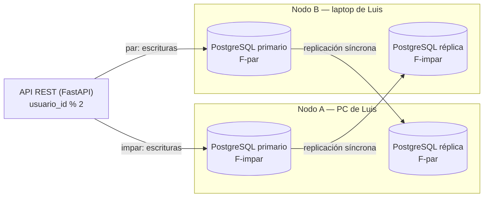

# Distribución de datos por usuario

Issue relacionado: #3. Responsable: Osvaldo Yair Serna Salazar.

Este documento identifica las entidades principales de BANKDOIT, define cómo se reparten entre los dos nodos y muestra, con dos usuarios de ejemplo, dónde quedan sus apuestas y dónde se guarda su réplica. Es un diseño preliminar: los nombres de columnas y tipos se cerrarán en el script SQL de `database/`.

## 1. Nodos

| Nodo | Equipo | Aloja |
| --- | --- | --- |
| **Nodo A** | PC de escritorio de Luis (local) | Primario del fragmento impar y réplica del fragmento par |
| **Nodo B** | Laptop de Luis | Primario del fragmento par y réplica del fragmento impar |

Cada nodo ejecuta dos instancias de PostgreSQL en contenedores: una primaria (acepta escrituras) y una réplica de solo lectura del fragmento del otro nodo. Los nodos se comunican por VPN o túnel cifrado.

## 2. Entidades principales

Las entidades se dividen en dos grupos según cómo se distribuyen.

### 2.1 Datos del usuario (se fragmentan por `usuario_id`)

| Entidad | Qué guarda | Cómo llega al fragmento |
| --- | --- | --- |
| **Usuario** | `usuario_id`, alias, hash de contraseña, rol, estado | Por su propio `usuario_id` |
| **Bankroll** | Saldo disponible y límite semanal (uno por usuario) | Por `usuario_id` |
| **Apuesta** | Partido, selección, monto, cuota, estado, origen, fechas | Por `usuario_id` de quien apuesta |
| **Movimiento** | Tipo, importe, fecha, clave de operación, apuesta relacionada | Por el bankroll al que pertenece (mismo usuario) |
| **Recuerdo** | Referencia privada a la foto de una apuesta | Por la apuesta a la que pertenece (mismo usuario) |

Todas las filas de una persona viven juntas en el mismo fragmento. Así, consultar su saldo, su historial o su ROI se resuelve en un solo nodo y la transacción que registra una apuesta (apuesta + reserva del monto + movimiento) nunca cruza nodos.

### 2.2 Catálogo común (no se fragmenta)

| Entidad | Qué guarda |
| --- | --- |
| **Deporte** | Fútbol, fútbol americano |
| **Equipo** | Nombre y deporte |
| **Partido** | Deporte, equipo local, equipo visitante, fecha |

El catálogo es el mismo en los dos fragmentos y usa los mismos `partido_id`. Así, una apuesta del Nodo A y otra del Nodo B sobre el mismo encuentro apuntan al mismo partido, y las estadísticas globales por partido pueden sumarse.

## 3. Shard key y regla de asignación

- **Shard key:** `usuario_id`.
- **Regla:** `usuario_id` impar → fragmento impar (primario en Nodo A); `usuario_id` par → fragmento par (primario en Nodo B).
- **Directorio en la API:** la API aplica la regla `usuario_id % 2` para saber a qué primario enviar cada operación.

| Fragmento | Regla | Primario | Réplica |
| --- | --- | --- | --- |
| F-impar | `usuario_id % 2 = 1` | Nodo A | Nodo B |
| F-par | `usuario_id % 2 = 0` | Nodo B | Nodo A |

## 4. Ejemplo con dos usuarios

Datos sintéticos.

| usuario_id | Alias | Saldo inicial | Fragmento |
| --- | --- | --- | --- |
| 3 | `ana_gol` | $1,000 | F-impar |
| 4 | `beto_td` | $800 | F-par |

Partidos del catálogo (iguales en ambos nodos):

| partido_id | Deporte | Encuentro |
| --- | --- | --- |
| 101 | Fútbol | América vs Chivas |
| 202 | Fútbol americano | Chiefs vs Eagles |

### 4.1 Apuestas registradas

| apuesta | usuario_id | partido_id | Selección | Monto | Cuota | Estado |
| --- | --- | --- | --- | --- | --- | --- |
| A-1 | 3 | 101 | América | $100 | 2.00 | En curso |
| A-2 | 3 | 202 | Chiefs | $50 | 1.80 | Ganada |
| B-1 | 4 | 101 | Chivas | $200 | 3.10 | En curso |

Las apuestas A-1 y B-1 son sobre el mismo partido (101), pero quedan en nodos distintos porque pertenecen a usuarios distintos.

### 4.2 Dónde queda cada dato

**Usuario 3 (`ana_gol`, impar)**

1. La API calcula `3 % 2 = 1` y envía la operación al **primario F-impar en el Nodo A**.
2. En una sola transacción se guardan la apuesta A-1, la reserva de $100 en su bankroll y el movimiento de la reserva.
3. Antes de confirmar, el commit se replica de forma síncrona a la **réplica F-impar en el Nodo B**.

**Usuario 4 (`beto_td`, par)**

1. La API calcula `4 % 2 = 0` y envía la operación al **primario F-par en el Nodo B**.
2. En una sola transacción se guardan la apuesta B-1, la reserva de $200 y su movimiento.
3. El commit se replica de forma síncrona a la **réplica F-par en el Nodo A**.

### 4.3 Contenido de cada instancia

| Instancia | Usuario | Bankroll | Apuestas | Movimientos | Catálogo |
| --- | --- | --- | --- | --- | --- |
| Nodo A — primario F-impar | 3 | de 3 | A-1, A-2 | de 3 | 101, 202 |
| Nodo A — réplica F-par | 4 (copia) | de 4 (copia) | B-1 (copia) | de 4 (copia) | 101, 202 |
| Nodo B — primario F-par | 4 | de 4 | B-1 | de 4 | 101, 202 |
| Nodo B — réplica F-impar | 3 (copia) | de 3 (copia) | A-1, A-2 (copia) | de 3 (copia) | 101, 202 |

Cada nodo tiene los datos completos de los dos usuarios, pero solo puede **escribir** los de su fragmento. Las copias sirven para recuperación, no para registrar apuestas.

### 4.4 Saldos resultantes

| Usuario | Disponible | En juego | Ganancia neta | Cálculo |
| --- | --- | --- | --- | --- |
| 3 | $940 | $100 | +$40 | $1,000 − $100 (A-1) − $50 (A-2) + $90 (pago de A-2) |
| 4 | $600 | $200 | $0 | $800 − $200 (B-1) |

La apuesta A-2 ganada a cuota 1.80 paga $50 × 1.80 = $90, una ganancia neta de $40.

## 5. ¿Qué pasa si se cae un nodo?

| Escenario | Usuario 3 (impar) | Usuario 4 (par) |
| --- | --- | --- |
| Normal | Escribe en Nodo A | Escribe en Nodo B |
| Se cae el Nodo B | El primario sigue en el Nodo A, pero la réplica síncrona no responde: las escrituras quedan en espera y la app guarda borradores (se prioriza la consistencia, postura CP) | Su primario no está disponible: la app guarda borradores. Su copia en el Nodo A sigue intacta |
| Promoción controlada | Sin cambios | Tras aislar el Nodo B, se promueve la réplica F-par del Nodo A y el usuario 4 vuelve a escribir |
| Regresa el Nodo B | Se resincroniza como réplica | El Nodo B se resincroniza desde el nuevo primario antes de aceptar escrituras |

Con solo dos nodos, una desconexión por sí sola no autoriza promover la réplica, porque los dos nodos podrían creerse primarios (*split-brain*). La promoción se hace de forma manual y se documentará en las pruebas de falla.

## 6. Decisiones pendientes

| Tema | Propuesta | Acordar con |
| --- | --- | --- |
| Generación de `usuario_id` | Cada primario usa su propia secuencia con paridad fija: F-impar `START 1 INCREMENT 2`, F-par `START 2 INCREMENT 2`. La API elige el nodo al registrar al usuario y la secuencia garantiza que el id caiga en el fragmento correcto | Luis |
| Alias único entre fragmentos | Un `UNIQUE` local no evita que el mismo alias se registre en los dos nodos. Se propone un directorio `alias → usuario_id` en el catálogo común, que también sirve para que el login sepa a qué nodo ir | Luis |
| Escrituras del catálogo | La replicación física copia instancias completas, no tablas sueltas. Se propone que el catálogo tenga un solo dueño (primario F-impar) y se copie al primario F-par con replicación lógica (`PUBLICATION`/`SUBSCRIPTION`) | Equipo |
| Nombre del estado inicial | El README usa "pendiente" y el avance usa `en_curso`. Elegir uno antes del script SQL | Luis y Raúl |
| Equipo del Nodo B | Confirmar persona, equipo y conectividad | Equipo |
